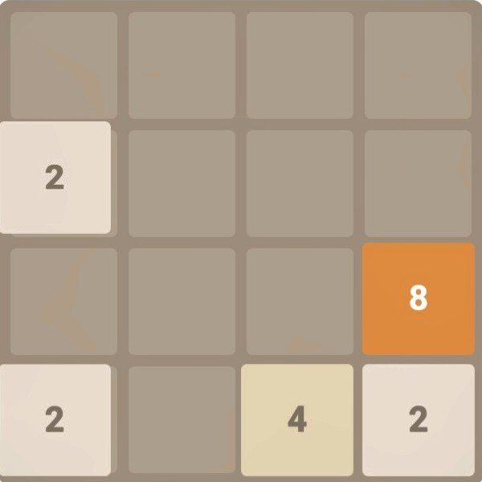

# TwentyFortyEight
2048 for windows 11 and android 14+ computers  

     

        

      

pro tip... killing the app wont start a new game, but the new game button will.  you can focus on moves and close the app and come back later to the same game

pro tip... on windows click swipe, arrow keys, and WASD also work to swipe the board
